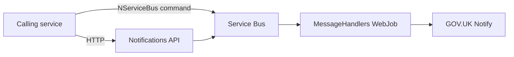

# Notifications - Developer Guide

How to set up, run and test the Notifications service locally. For what the service does and how other services use it, see the [README](../README.md).

## How it works

Callers either call the Notifications API, or send a `SendEmailCommand` / `SendSmsCommand` over NServiceBus. Either way, the command goes via Service Bus to the MessageHandlers WebJob, which sends it to GOV.UK Notify.



In deployed environments, NServiceBus uses Azure Service Bus and the MessageHandlers connect to SQL using an Azure AD access token. Locally, NServiceBus uses the learning transport and SQL uses the connection string as-is.

The build pipeline pins `das-platform-building-blocks` to `3.0.0`. Tags from `3.0.29` onwards add required parameters to the SQL dacpac deploy template, so `pipeline-templates/job/deploy.yml` would need updating before moving to a newer tag.

## Prerequisites

- .NET 10 SDK
- Visual Studio with the SQL Server Data Tools workload
- SQL Server (LocalDB or local instance)
- Azurite
- Access to `das-employer-config`

## Setup

### 1. Configuration

Start Azurite and load the `das-notifications` configuration from `das-employer-config` into the `Configuration` table:

| PartitionKey | RowKey | Used by |
|---|---|---|
| `LOCAL` | `SFA.DAS.Notifications.MessageHandlers_1.0` | Api, MessageHandlers, TestHarness |
| `LOCAL` | `SFA.DAS.Notifications-Templates_1.0` | MessageHandlers |

In `SFA.DAS.Notifications.MessageHandlers_1.0`, set:

- `DatabaseConnectionString` - your local database
- `NotificationServiceApiKey` - a GOV.UK Notify test API key (optional - see below)
- `ApiAuthentication` - local values for `ApiIssuer`, `ApiAudiences` and `ApiTokenSecret` (32+ characters), if you want to call the API

These environment variables control local behaviour. You don't need to set them - if they're missing, the local values below are used:

| Variable | Local value | Notes |
|---|---|---|
| `APPSETTING_EnvironmentName` | `LOCAL` | Uses the learning transport instead of Service Bus, and the SQL connection string as-is instead of an Azure AD token |
| `APPSETTING_ConfigurationStorageConnectionString` | `UseDevelopmentStorage=true` | Loads configuration from Azurite |

### 2. Database

Right-click `SFA.DAS.Notifications.Database` > **Publish**, and publish to your local SQL Server.

## Running locally

### Message handlers

1. Set `SFA.DAS.Notifications.MessageHandlers` as the startup project
2. Press F5

The console shows NServiceBus starting. It then waits for messages.

### Test harness

Sends test messages straight to the message handlers, without going through the API.

1. Set multiple startup projects, in this order:
   - `SFA.DAS.Notifications.MessageHandlers`
   - `SFA.DAS.Notifications.MessageHandlers.TestHarness`
2. Press F5
3. In the TestHarness console, press **A** to send an email or **B** to send an SMS

Without a valid Notify key, messages are processed and then fail with `403 Invalid token: API key not found`. This is expected, and shows everything up to Notify is working.

### API

1. Set multiple startup projects:
   - `SFA.DAS.Notifications.MessageHandlers`
   - `SFA.DAS.Notifications.Api`
2. Press F5. Swagger opens at `https://localhost:5001/`
3. Create a JWT using your local `ApiAuthentication` values. It must be signed with HS256 using `ApiTokenSecret`, and have these claims:
   - `iss` - `ApiIssuer`
   - `aud` - one of the `ApiAudiences`
   - `role` - `SendEmail` and/or `SendSMS`
   - `exp` - a time in the future
4. In Swagger, click **Authorize** and enter `Bearer <token>`
5. Send a request to `POST /api/email` or `POST /api/sms` - see the [Functionality section of the README](../README.md#functionality) for request bodies

### Tests

```
dotnet test src/SFA.DAS.Notifications.sln
```

## Testing in Azure

The easiest way to test a deployed environment is to trigger an email from a service that uses Notifications, for example submitting an application in AODP. Then check the email arrives and the `SFA.DAS.Notifications.MessageHandlers-errors` queue is empty.

## Troubleshooting

| Error | Fix |
|---|---|
| `Invalid object name 'dbo.OutboxData'` | Publish the database project |
| `403 Invalid token: API key not found` | Expected without a valid Notify key |
| `401 Unauthorized` from the API | Token issuer, audience or secret doesn't match your config |
